  

**Building the ecosystems of tomorrow, today.**

Pixra Global is an emerging tech organization engineering scalable B2B and B2C products, complete digital ecosystems and next-generation solutions. We work where modern web architecture, systems engineering in C++ and intelligent design meet.

Today we run **QuduHub**, our general-purpose AI workspace. Next up is **Ridel**, a map intelligence application for all of India, launching in 2027.

  

Founded and architected by **[Radhe Bharadwaj](https://github.com/Radhebharadwaj)**, a tech architect focused on high-performance systems and the future of AI.

