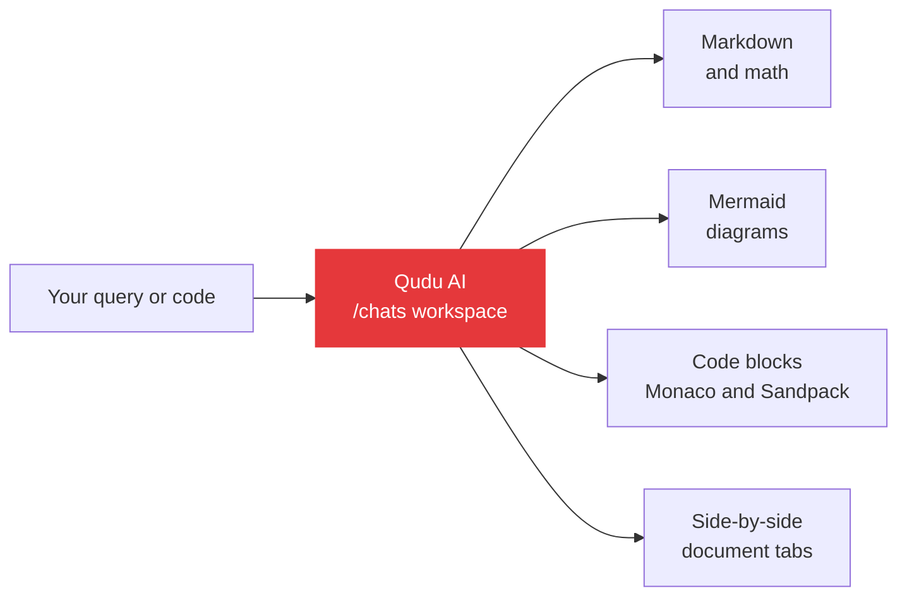

  

 

  

[**Launch Workspace**](https://qudu.in/chats)  &nbsp;·&nbsp;  [Qudu AI](https://qudu.in/ai)  &nbsp;·&nbsp;  [Store](https://qudu.in/store)  &nbsp;·&nbsp;  [Community](https://qudu.in/community)  &nbsp;·&nbsp;  [About](https://qudu.in/about)

<!-- OPTIONAL: product demo. Put a 8-12s screen recording at assets/demo.gif (max ~10 MB) and uncomment.

  

-->

**[QuduHub](https://qudu.in/)**, also called **Qudu**, is a general-purpose AI workspace for thinking, research and creation, developed under [Pixra](https://github.com/pixra). It brings conversational intelligence, document exploration and code analysis into one focused environment, built for writers, engineers, researchers and students alike.

Qudu is not a disconnected chatbot tab. **Qudu AI lives inside the workspace**, side by side with your documents, code snippets and personal preferences, so you can synthesize ideas and debug implementations without switching windows.

> **Pre-Launch Preview.** Qudu is actively evolving. What works today is listed honestly below, along with what is still experimental or in development.

<!-- OPTIONAL: main screenshot. Save as assets/screenshot-chat.png and uncomment.

  

-->

Transparent classification of what is ready today and what is still being built.

QuduHub is architected for speed and resilience on modern web infrastructure. Responses render as rich markdown with math, Mermaid diagrams are drawn inline, and code runs through integrated **Monaco** and **Sandpack** viewers.

<b>View as Mermaid diagram</b>

> The core application logic and backend repositories are maintained privately to protect security and product integrity during the testing phase.

No setup required.

Founded and architected by [**Radhe Bharadwaj**](https://qudu.in/about/radhe-bharadwaj), a tech architect focused on high-performance systems and the future of AI.

 

